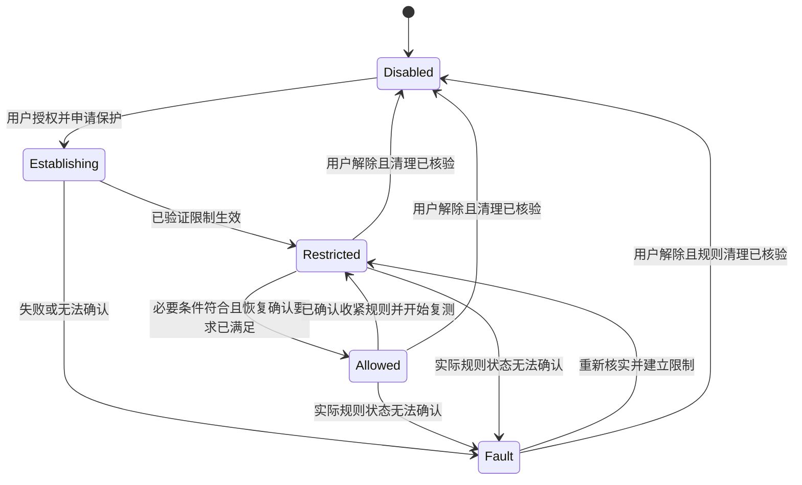

# 无间道：技术方案与开发清单

版本：1.0 · 更新：2026-10-21 · 状态：目标架构与任务拆解；当前已实现范围和验收见《开发进度》。系统保护组件尚未实现。

本文件配合《需求规格》和《界面与动效设计》使用。策略判定、探测、进程操作和保护状态由 Rust 与系统组件负责；前端展示事实、收集选择、发起结构化操作。

## 1. 技术选择

| 层 | 选择 | 理由与约束 |
| --- | --- | --- |
| 桌面 | Tauri 2、Rust | 统一桌面壳、托盘、事件与本地模块；不将其视为跨平台防火墙 |
| 前端 | React、TypeScript、Vite | 工具列表与多状态交互；使用稳定版本并在初始化时锁定依赖 |
| 样式 | CSS Modules、CSS 自定义属性 | 小型桌面界面可直接控制；减少现代 CSS 框架对旧 WebView 的额外要求 |
| 交互 | Motion，使用 `motion/react`；简单过渡用 CSS | 仅引入必要能力，遵守减少动态效果 |
| 图标 | lucide-react | 统一尺寸、笔画与可读名称，按需导入 |
| 本地任务 | Tokio、显式配置的 HTTP 客户端、平台适配器 | 请求可取消、有超时、路径可追溯、不隐式回退 |
| 存储 | Rust 管理的 SQLite 与配置文件 | 前端不直接执行 SQL；配置有 schemaVersion，规则有独立恢复清单 |
| 凭据 | 系统凭据存储 | 仅按需保存用户已有的本地控制接口凭据；不读取 AI 登录密钥 |

不采用远程页面、在线字体、运行时 CDN 或默认遥测。前端不需要服务器渲染。最低 OS、WebView 和依赖版本在首个构建任务中固定，不将“能构建”当作“保护已验证”。

候选首轮验证环境：macOS 14+（先 Apple Silicon）、Windows 11 x64、Ubuntu 24.04 LTS x64。它们是验证起点，其他架构、发行版、旧版本和 WSL 不自动继承支持结论。

## 2. 模块边界

```text
React 界面 / 托盘
        │ 结构化 command、snapshot、event
Rust Core
  ├─ ToolRegistry         安装发现、身份与启动信息
  ├─ LocalInspector       DNS、路由、代理与配置读取
  ├─ ProbeScheduler       API、网络变化、取消、退避
  ├─ PolicyEngine         证据有效性、必要项与下一步
  ├─ Launcher             系统终端、参数、会话关联
  ├─ LocalStore           配置、记录、脱敏导出
  └─ ProtectionClient     已验证的本地 IPC
           │
     系统辅助服务 / 平台保护实现
           └─ 限制、允许路径、实际状态、恢复
```

UI 或 Rust 普通用户进程退出，不应自动撤销已建立的保护。检测调度与必要证据过期处理在保护模式下交由可持续工作的辅助服务协调；界面重新打开后查询实际快照。

辅助服务只接受有限、带版本的策略操作。安装目录、可执行文件和规则清单使用系统所有权保护，不使用用户可改写的 Python/Shell 脚本作为高权限常驻入口。

## 3. 平台能力与验证策略

下列系统保护能力均为计划，执行器及实机阻断验证尚未开始；工具发现和只读检测已有预览实现，详见《开发进度》。开发中每个单元记录实现状态、验证状态、权限、适用工具形态与证据编号。

| 能力 | macOS 方向 | Windows 方向 | Linux 方向 |
| --- | --- | --- | --- |
| 工具发现 | Applications、固定目录、PATH、用户选择 | 应用清单、固定目录、PATH、用户选择 | desktop 条目、固定目录、PATH、用户选择 |
| DNS 配置 | 系统解析状态、作用域、`/etc/resolver`、本地监听 | 网卡 DNS、有效 NRPT、可获取的加密 DNS 设置 | resolv.conf 实际目标、resolved/NetworkManager、路由 |
| CLI 启动 | 系统终端适配器与固定启动包装器 | Windows Terminal/系统可用终端适配器 | 可用终端的参数化适配器 |
| 访问控制候选 | Network Extension 内容过滤及所需系统组件，先做能力验证 | WFP/ALE 服务，按身份和地址族验证 | 受控 cgroup/nftables 或独立网络会话方案，先验证进程边界 |
| 存量连接 | 独立测试；失败时不接管既有会话 | 独立验证重新授权/断流行为 | 独立验证现有 socket、conntrack 与命名空间 |
| 解除与恢复 | 只移除本软件组件及规则 | 自有 provider/filter 标识与恢复清单 | 自有 table/chain/对象与恢复清单 |

系统版本、签名、授权和发布要求与“用户无需检测服务账号”是不同事项。macOS 保护能力应在美化完整界面前完成小型技术验证，避免晚期发现工具身份或部署方式不适用。

Linux 独立网络命名空间只能约束进入其中的会话，不能自动约束用户另开终端的同一工具。Windows/macOS 的应用身份规则也不自动识别所有脚本或子进程。适配器必须返回真实 coverage：`application_all_entries` 或 `managed_session`，不满足用户要求时禁止开启该范围。

共享 DNS 服务的流量归因单独处理；不能简单封禁 mDNSResponder、svchost 或 systemd-resolved 影响整机解析。DNS 泄露预防未验证时，能力矩阵必须保留缺口。

## 4. 核心数据与判定契约

前后端共享以下概念，具体代码由 Rust 类型生成或核对 TS 类型，避免两份枚举逐渐不一致。

```ts
type GuardState =
  | "disabled" | "establishing" | "restricted"
  | "allowed_by_policy" | "fault" | "unsupported";

type CheckState =
  | "not_run" | "running" | "match" | "deviation"
  | "review" | "unknown" | "stale" | "not_applicable";

type Scope =
  | "host_config" | "system_resolver" | "proxy_resolver"
  | "probe_path" | "managed_session" | "application_all_entries";

interface Evidence {
  id: string;
  checkId: string;
  state: CheckState;
  scope: Scope;
  pathId?: string;
  addressFamily?: "v4" | "v6";
  source: string;
  integrity: "local_verified" | "tls_verified" | "http_unverified" | "unverified";
  observedAt: string;
  expiresAt?: string;
  networkEpoch: number;
  policyRevision: number;
  reasonCode?: string;
}
```

ToolRecord 另含逻辑 ID、用户可见名称、工具类型、规范化可执行路径、安装形态、平台身份信息及发现/启动/保护三个能力。完整路径只保存在本机，不放入常规事件或导出默认内容。

NetworkPolicy 必须强制约束允许地区与 DNS 路径，未知不得放行。含 revision、toolIds、明确的保护范围、允许的本地端点或已验证网络路径、DNS/IPv6 策略、requiredChecks、证据 TTL、恢复方式和外部探测选择。远端出口 IP 白名单只按已有观测能力解释，不能声称本地防火墙能直接校验代理远端所见 IP。

GuardSnapshot 含 desiredMode、actualState、coverage、policyRevision、ruleGeneration、recoveryRequiresConfirmation、已验证规则摘要、辅助服务状态、观测时间及缺口。`desiredMode=protect` 不是保护成功证据，`fault` 也不意味着已经解除限制。

必要项的 `review/unknown/stale/running/not_run` 均不能放行。`not_applicable` 只有经策略引擎验证确实不适用时才可排除；界面不能自行把必要项改为可选。

networkEpoch 在网络、DNS、所选代理路径或休眠状态变化时递增。异步结果必须同时匹配当前 epoch、策略版本和工具身份，旧请求即使迟到成功也不能恢复访问。

## 5. 状态推进与规则操作



UI 状态只跟随后端确认；网络事件发生但尚未确认收紧成功时，显示“正在收紧／状态待确认”，不能提前声称已限制。实现上可使用 establishing 或附带 operation 状态，不新造一个伪成功状态。

保护操作按“生成计划 → 本地确认与系统授权 → 检查身份/版本 → 建立限制 → 验证 → 探测 → 开放允许路径 → 再核验”执行。计划包含唯一 ID、目标和影响、旧/新规则版本及有效期。

并发操作串行化；重复请求按 operationId 去重。更改策略先收紧再替换允许项，不先清空所有规则；更新失败保留或恢复已确认的限制。对无法保证这一点的平台，保护能力不进入发布范围。

恢复默认需必要检查通过后用户点击；恢复动作仍核对当前 epoch 和规则版本。解除保护是独立操作，带影响说明，只删除本软件拥有的对象。辅助服务失联时不能显示“解除成功”，需提供单独的恢复工具。

首次启用时 recoveryRequiresConfirmation=false，可按既有授权在必要条件通过后放行。异常导致收紧或保护故障后设为 true；复测成功只解锁“恢复访问”，不能自动放行。启动命令在限制状态拒绝执行，不隐式替用户恢复。

放行条件为 `allRequiredValid && rulesVerified && (!recoveryRequiresConfirmation || userConfirmedRecovery)`；确认必须绑定本次策略、网络 epoch 和操作，旧确认不可复用。

不依赖 UI 心跳维持规则。辅助服务崩溃、机器重启与用户撤权后的行为必须实测记录；无法做到预期的故障限制时明确能力不足，不能按愿望填写状态。

## 6. Provider 与调度约定

### 6.1 公网 IP

- IPv4：`https://api.ipify.org?format=json`；IPv6：`https://api6.ipify.org?format=json`。
- HTTPS 证书正常校验；响应必须为合法地址且符合端点族别。超时/失败不回退直连或改用其他未经选择的服务。
- HTTP 客户端显式选择路径；系统代理、环境代理、NO_PROXY 和客户端默认行为不能暗中改变已展示的路径。
- 使用显式代理时，IPv6 目标、第一跳地址族及返回的公网地址分别记录；不凭 `api6` 请求失败判定全范围禁用 IPv6。

### 6.2 ip-api DNS

- 为每次新观测生成 32 位随机字母数字主机名，使用官方 `edns.ip-api.com` 域名体系；随机值不含设备或账户标识。
- 默认优先直接使用随机域名，避免依赖入口跳转。过期只在受限次数内生成新任务，不能无限跟随跳转。
- 系统解析模式先通过操作系统正常解析入口查询该主机名，再以严格校验的目标地址和对应 Host 取回本次结果；此实现须用可控测试验证没有触发另一套解析或改变请求归属。
- 通过代理将域名交给远端解析时，明确记录 `proxy_resolver`；不可标记为系统解析测试。按 IP 取回结果也不证明该查询与 AI 域名分流一致。
- HTTP 仅在用户已选择相应外部诊断后使用，结果标 `http_unverified`，只作辅助；HTTPS 能力另做验证，不自动降级。
- 仅解析已知 JSON 字段，不执行响应中的链接、命令或脚本；控制目标、响应体积和重定向范围，不请求任意内网地址。

建议起始限制：单项总超时 10 秒、单响应上限 64 KiB、全局外部并发 2；IP 轮询 60 秒，DNS 10 分钟，网络事件合并 1 秒。失败按 30 秒、60 秒、120 秒递增退避，上限 10 分钟，尊重服务返回的限流信息。

暂停、关闭授权、策略变更或任务被新 epoch 取代时取消对应任务。仅检测模式无活跃会话时停止周期探测；保护模式保留必要状态管理，用户可单独暂停外部探测。没有同意的服务不得先请求再告知。

## 7. Tauri 命令与事件

| 命令 | 输入 | 输出 / 约束 |
| --- | --- | --- |
| get_app_snapshot | 无 | 工具、能力、检查和保护快照；UI 打开/重连时调用 |
| discover_tools | 支持的扫描范围 | 安装发现结果；不运行工具、不扫描整盘 |
| add_tool | 用户选定的文件或应用 | 规范化身份与各项能力；不自动纳入保护 |
| run_checks / cancel_checks | toolId、policyRevision、pathId / runId | 任务 ID / 取消结果；由后端检查外部授权 |
| save_policy | 结构化策略、expectedRevision | 新版本或冲突错误；不立即暗中改规则 |
| prepare_protection | toolId、策略版本 | 范围、影响、缺口、可执行计划 |
| enable_protection | planId、operationId | 后台操作 ID；权限结果由系统确认 |
| resume_access | toolId、operationId | 仅当当前证据与规则满足条件时执行 |
| disable_protection | toolId、operationId | 撤回本软件规则并返回实际核验结果 |
| launch_tool | toolId、已验证工作目录 | 固定工具适配器启动；保护模式先核验策略 |
| export_report / delete_history | 预览后的脱敏选项 / 时间范围 | 用户选择位置导出 / 记录清理；不删除活动保护配置 |

事件为 tools_changed、check_updated、guard_changed、network_changed、timeline_added。事件包含 eventId、递增 sequence、revision 与时间。重连或序列有缺口时重取快照；事件是刷新依据，不能替代实际状态核验。

前端只传逻辑 ID 和结构化选择；不传待执行 Shell 命令、防火墙脚本或任意下载地址。后端验证路径、参数、所有权、请求者身份和计划有效期；Tauri capabilities 只开放必要命令，不向远程网页暴露系统能力。

CLI 在系统终端启动；先实现固定适配器，不提供任意命令输入框。严格区分程序路径、工作目录和参数，逐平台处理引用规则。受控会话建立保护边界后才启动业务进程；不靠启动通知事后补规则。

## 8. 开发任务与完成标准

| 编号 | 任务 | 依赖 | 可审查的完成结果 |
| --- | --- | --- | --- |
| D01 | 初始化 Tauri/React/TS 与锁文件、基础 capabilities、平台构建 | 无 | macOS 本机能打开空壳；其余平台 CI 编译状态单独记录 |
| D02 | tokens、列表、抽屉、引导、记录和设置的演示 | D01 | 可切换完整状态，常驻演示标识，无真实规则操作 |
| D03 | Rust/TS 契约、快照、事件、状态判定 | D01 | 旧 epoch 不恢复、未知不通过、重连同步可验证 |
| D04 | 工具发现、三个平台本地检查和建议 | D03 | 无隐式运行工具；读取失败保留原因；各平台有真实样例 |
| D05 | ipify 与 DNS Provider、告知、路径和取消 | D03 | 无密钥可用；无授权零探测；失败不回退；DNS 解析位置准确 |
| D06 | 首个 macOS 保护技术验证 | D03，可与 D02/D04 并行 | 选择一种工具形态；确认部署、身份、先限后测、代理退出和恢复 |
| D07 | 日志、网络变化、通知、终端启动 | D04/D05 | 同类变化去重，导出脱敏，启动不引入任意命令执行 |
| D08 | 首个平台保护闭环及 UI 接线 | D06/D07 | UI 关闭仍限制、故障准确、过期收紧、用户恢复、解除与回滚 |
| D09 | Windows/Linux 保护适配 | D08 的契约，可并行实现 | 按平台与工具完成相同验证，coverage 不混用 |
| D10 | 签名、打包、升级/卸载、公开说明 | 目标平台验收完成 | 发布物能力与覆盖矩阵一致；可恢复；依赖许可和数据流可审查 |

D06 是早期技术验证，应在 D02 界面仍在迭代时进行。它若发现不可满足的保护边界，先调整支持矩阵和入口说明，再投入大范围适配；不让前端样机把尚未实现的能力包装成产品事实。

不承诺未经验证的开发天数。先完成一个可以真实审查的纵向流程，再扩大工具清单；三系统最终目标不因中间检测预览版本而取消。

## 9. 测试与发布证据

- Rust 判定测试：必要项未知/过期、版本冲突、旧请求迟到、规则状态故障、HTTP 辅助证据不可授权放行。
- Provider 集成测试：可控解析与响应夹具覆盖成功、限流、超时、无效 JSON、过大响应、重定向、取消与路径失效，不向真实 AI 服务发送测试业务请求。
- UI 测试：演示/真实模式隔离、双状态、焦点、减弱动效、最小窗口和暗色；人工截图与交互复核。
- 原生保护测试：独立测试进程与可控端点，覆盖 IPv4/IPv6、TCP/UDP、DNS、已有连接、子进程、其他入口及恢复。系统修改只在明确授权的测试机或隔离环境执行。
- 端到端可评估 WebdriverIO Tauri embedded provider；当前 Tauri 官方文档已提供三平台方案。仅在测试构建启用测试服务，发布物不携带自动化后门；原生过滤验证不能由 WebDriver 点击成功代替。

每个保护组合记录：OS/架构、工具版本及形态、权限、规则版本、coverage、场景步骤、期望/实际、抓取或日志证据、恢复结果和未覆盖项。当前文档不包含任何通过记录。

## 10. 已检查的本机开发环境

2026-10-21 仅执行版本读取，未安装或升级依赖：Node v22.22.3；pnpm 11.25.0；rustc/cargo 1.91.1；Xcode 当前选中 `/Applications/Xcode-beta.app/Contents/Developer`。

工具存在不代表构建链已通过。D01 核实选定依赖的最低版本、Xcode SDK、签名目标与平台编译；正式发布前单独验证稳定版 Xcode 工具链。Windows/Linux 尚未检查，不填为就绪。

## 11. 参考

- [Tauri capabilities](https://v2.tauri.app/security/capabilities/)：最小命令权限与远程内容边界。
- [Tauri WebDriver](https://v2.tauri.app/develop/tests/webdriver/)：当前三平台自动化路径与原生 driver 的区别。
- [Motion 安装](https://motion.dev/docs/react-installation)、[减少动态效果](https://motion.dev/docs/react-accessibility)。
- [Tailwind 兼容性](https://tailwindcss.com/docs/compatibility)：本项目选择 CSS Modules，避免在未定 WebView 基线时额外引入该框架门槛。
- [Apple Network Extension 部署](https://developer.apple.com/documentation/technotes/tn3134-network-extension-provider-deployment)：macOS 技术验证入口，不视为特定工具已获完整覆盖。
- [Microsoft WFP/ALE](https://learn.microsoft.com/en-us/windows/win32/fwp/application-layer-enforcement--ale-)：应用身份及连接过滤。
- [Linux network namespaces](https://www.man7.org/linux/man-pages/man7/network_namespaces.7.html)：命名空间的实际作用范围。
- [ipify](https://www.ipify.org/)、[ip-api DNS](https://ip-api.com/docs/dns)：检测 Provider 的当前契约。

## 12. 强制要求修订

用户已确认系统级保护为正式版必备项。允许地区、DNS 路径、规则和证据有效性均为强制必要条件。当前新增 `guard.rs` 纯策略与原生启动门禁，实际系统执行器仍 unsupported；禁止将门禁拒绝或诊断 API 成功显示为系统已阻断。完整边界及验收见[系统级强制保护方案](系统级强制保护方案.md)。
